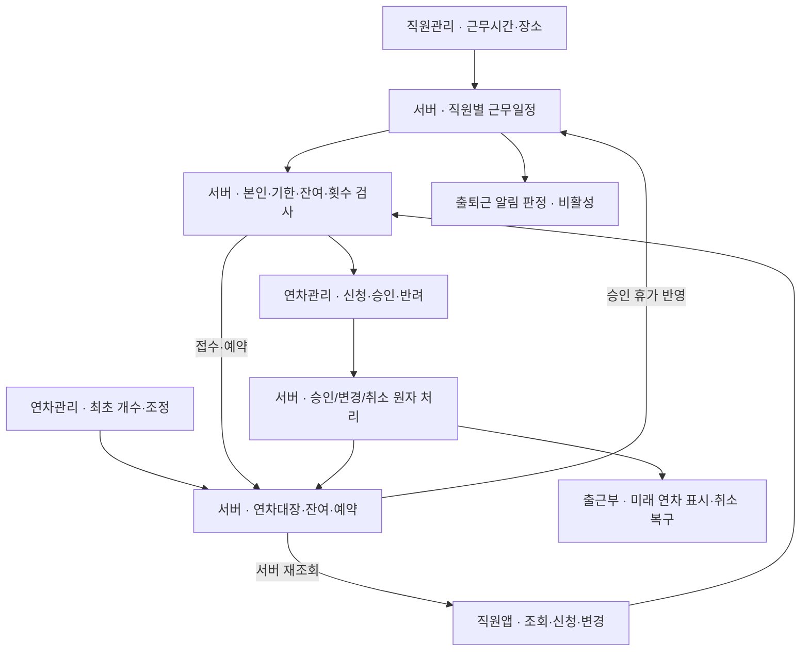

# 근무시간·연차 연결 구조 점검

2026-11-03 / main 3dda6b2 기반. 현재 구현과 이번 홍보팀장 근무시간 권한 변경을 구분한다.

연차 개수 최초 등록·조정은 **연차 관리 → 직원별 연차 등록·현황**에서 한다. 직원관리는 근무시간·장소 입력을 맡는다. 두 메뉴가 같은 잔여값을 따로 저장하지 않는다. 이전 사용자 결정대로 연차 입력 중복은 제거된 상태다.

표시된 연결은 기존 Auth → Person → 불변 employee UUID를 사용한다. 화면이 employee UUID만 보내도 서버가 본인/승인 권한을 다시 판단한다. 승인 대기 신청은 잔여를 예약하지만 승인된 휴가처럼 근무일에서 제외하지 않는다. B→S의 휴가 반영은 연차 요청의 approved 상태를 읽는 schedule projection을 뜻하며 연차 잔여 숫자로 근무일을 추정하지 않는다.

| 책임 | 실제 연결 코드 | 확인 |
| --- | --- | --- |
| 근무시간 입력·적용일 이력 | employee-management-views.js → employee-leave.js renderWorkTerms → save_employee_work_terms / save_employee_work_override | 구현. 이번 변경에서 promotion_lead 입력 허용 |
| 최초 연차·잔여·조정 | employee-leave.js populate(leaveOnly=true) → initialize_employee_leave / adjust_employee_leave | 별도 연차관리만 입력. 운영총괄 유지 |
| 앱 신청·대기 예약 | mobile/app/leave.tsx → leave-api.ts → submit_my_leave_request | KST 3일 기한·근무일·잔여·행 잠금. 직원 수정 불가 |
| 관리자 승인·반려 | renderRequests → review_employee_leave | 운영총괄/운영팀장. 승인 대장 차감과 출근부 상태를 같은 트랜잭션에서 기록 |
| 미래 출근부 | private_attendance_effective_status → get_attendance_admin_today → attendance-monthly.js | 승인 즉시 미래 연차 표시. 기존 확정 근태는 재개방 규칙 유지 |
| 수정·취소 | edit_my_pending_leave / request_my_leave_change / review_employee_leave_change | 승인 전 반복 수정, 승인 후 수정 요청 1회. 변경 승인 전 기존 일정 유지. 취소 복구 중복 방지 |
| 앱 잔여 갱신 | get_my_leave_context + use-my-leave.ts | 신청/변경/취소 후·화면 진입·foreground 조회. 물리 단말 왕복은 미확인 |
| 매월 +1 | private_accrue_employee_leave / private_reconcile_leave_monthly | 기준일까지 포함·직원/월 중복 방지·조회 보충 구현. 정기 예약은 미활성 |
| 출퇴근 알림 제외 | private_employee_schedule → reminder outbox → attendance-reminders | 승인 휴가 공유. 발송 기본 OFF·실기기 Push 미검증 |

## 발견한 권한 결합과 수정

기존 renderWorkTerms는 can_initialize를 사용했고, 근무시간 저장과 연차 최초 개수/조정 RPC가 같은 employee.work_terms_manage capability를 검사했다. 따라서 역할 grant만 추가하면 연차 개수 수정 권한도 함께 넓어질 수 있었다.

이번 변경은 기존 capability를 재사용해 근무시간 등록을 허용하고, 연차 최초/조정은 operations_manager AND capability로 제한한다. public 관리자 context의 can_manage_work_terms/can_initialize를 별도로 반환한다. 새 서비스나 별도 연차 잔여 저장소를 만들지 않는다. 직접 RPC 권한 검사와 두 메뉴 화면을 함께 검증한다.

## 남은 운영 단계

- 월 1일 정기 실행 예약은 아직 없다. 조회 시 보충되지만 정기 배치 활성화를 완료한 것은 아니다.
- 실직원 Push와 예약은 OFF다. 실기기 수신/알림 터치/출근 후 후속 제외는 물리 기기 검증이 필요하다.
- 설치된 QA APK의 실제 신청 모드·버전 확인이 필요하다. 화면 체험은 합성 데이터만 사용한다.
- 하단 탭 PR577은 별도 Draft다. 이 흐름 점검이나 서버 적용을 앱 배포 완료로 해석하지 않는다.
- 실제 적용 이력/검증 수치는 WORK_TERMS_LEAVE_V1_IMPLEMENTATION.md 및 해당 PR의 최신 HEAD를 따른다.
