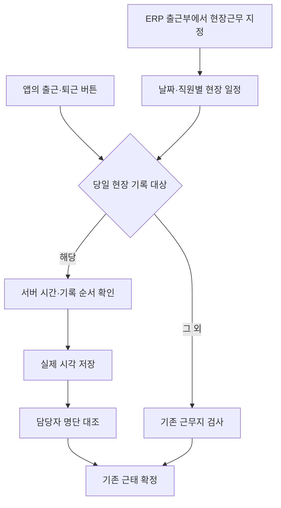

# 현장근무 출퇴근

출근부 확인 날짜를 선택하고 현장명, 시작·종료 시각, 참여 직원, 현장 출근 포함 여부를 지정한다. 직원당 하루 한 현장을 지원한다. 휴일에는 기존 휴일근무 지정도 필요하다. 승인 휴가·휴무 및 근태 제외 직원은 현장 기록에서 제외한다.

- 현장 출근은 시작 30분 전부터 종료 시각까지, 퇴근은 종료 전후 1시간이다. 날짜는 서버의 한국 날짜로 판단한다. 범위를 지난 기록은 근태 보정을 이용한다.
- 본사 출근 후 현장 해산이면 퇴근에만 현장 규칙을 적용한다. 지각과 조퇴는 현장 예정 시각과 실제 시각을 대조할 수 있게 표시한다.
- 현장 기록에는 GPS 좌표 대신 일정 ID가 남는다. 기존 출근부 확인 권한으로 담당자가 기록을 대조하며 본인 기록을 스스로 확인할 수 없다. 확인 전 근태 확정은 막는다.
- 기록이 생긴 일정은 변경·삭제할 수 없다. 오류는 기존 보정 흐름에서 다룬다. 웹과 직원앱은 동일한 서버 함수를 사용한다.
