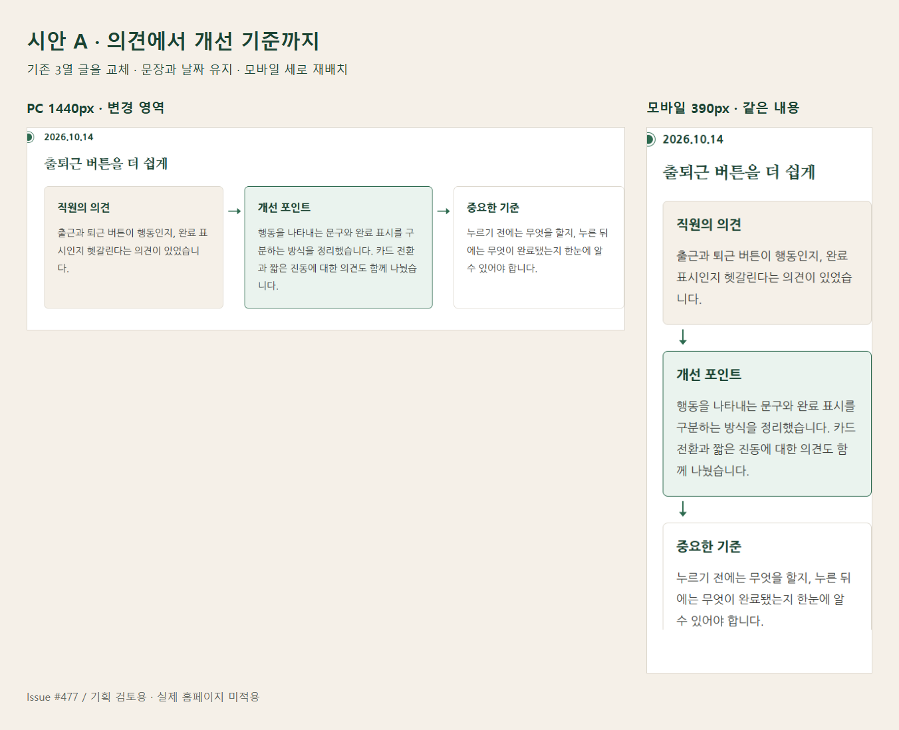
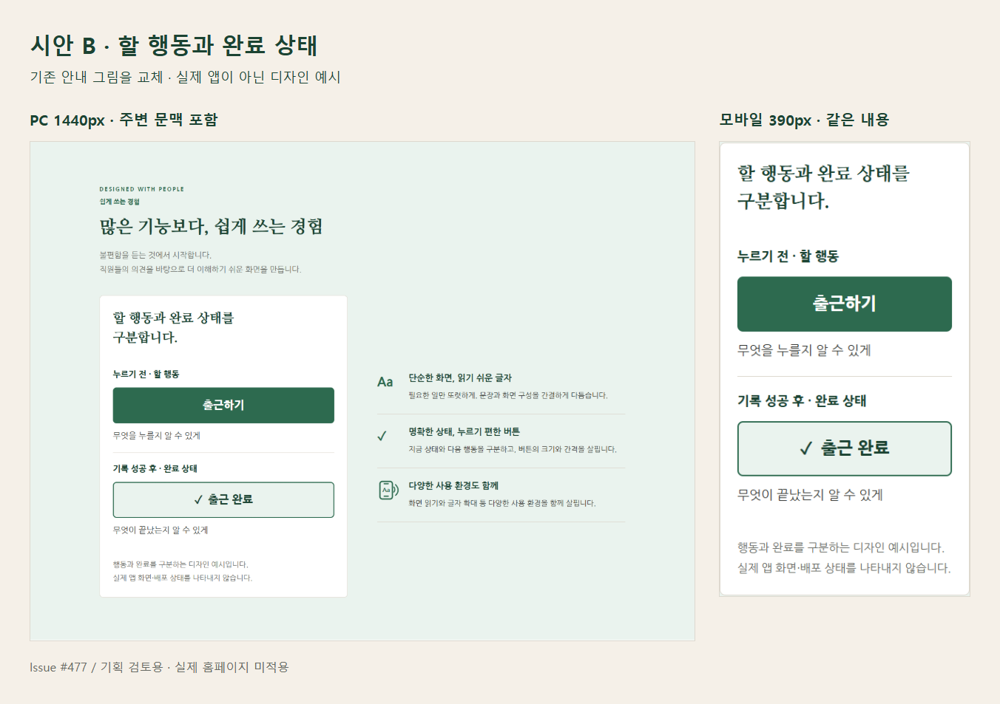

# 직원앱 랜딩페이지 다이어그램 디자인 검토 — Issue #477

> 2026-10-17 V2.1: [최신 독립 검토](https://github.com/cetin072/taejang_homepage/issues/477#issuecomment-6218944671)를 반영한 **V2 6.8초 ↔ V2.1 5.2초 동기 비교**를 추가했다. [시안·비교·검수 기록](previews/issue-477/motion-v2-1/NOTE.md). V2 원본은 보존하며 최종 선택·전문가 수준 디자인 승인·A안 모션 착수는 아직 보류다.

> 2026-10-17 V2 보완: 아래는 1차 정적 구조 기준선으로 보존한다. 최신 요청은 **HERO 모션그래픽 작동 시안 우선 평가**이며 A안의 실제 모션 적용은 그 뒤 결정한다. [V2 콘티](previews/issue-477/motion-v2/STORYBOARD.md) · [작동 시안·비교·검수 기록](previews/issue-477/motion-v2/NOTE.md). 기존 A/B 제안을 최종 구현·배포 승인으로 취급하지 않는다.

- 작성: 2026-10-16
- 상태: **검토 중 / 홈페이지 미구현 / 사용자 디자인 선택 대기**
- 기획 원본: [Issue #477](https://github.com/cetin072/taejang_homepage/issues/477)
- 비교 기준: `origin/main`의 `7983c988f19a6c10fa96fee808babe1ebc996614`
- 보호할 선행 결정: Issue #459, 병합된 PR #460 및 #470의 공개 문구·모션·아이콘·메뉴·로그인 안내 계약
- 범위: 공개 직원앱 소개 페이지의 시각적 설명. 직원앱·DB·로그인·근태 로직 및 실제 홈페이지 파일은 수정하지 않는다.

## 1. 섹션별 판단

| 기존 섹션 | 현재 전달하는 내용 | 제안 | 설명 효과와 제외 이유 |
| --- | --- | --- | --- |
| HERO | 앱 목적과 출퇴근·공지 기능을 휴대폰 안내 그림으로 소개 | 유지 | 이미 그림과 문장이 역할을 나눈다. 새 도식은 중복이다. 기존 안내 그림 고지·느린 일회성 모션을 보존한다. |
| DAILY GUIDE | 출근 기록·공지 확인·퇴근 기록의 독립 카드 | 유지 | 기능 목록은 카드로 충분하다. 번호나 방향 화살표를 추가하면 공지를 반드시 두 번째에 확인하는 절차로 오해할 수 있다. 기존 점선도 실제 순서가 아니라는 설명을 유지한다. |
| DESIGNED WITH PEOPLE | 읽기 쉬운 글씨·명확한 상태·다양한 환경 | **B안: 기존 예시 교체 후보** | 추상적인 ‘완료 상태도 명확하게’를 실제 문구 ‘출근하기 / 출근 완료’로 비교한다. 새 도식을 옆에 덧붙이지 않는다. 세로 길이 증가 및 실행 버튼 오해 가능성을 평가해야 한다. |
| DEVELOPER NOTES | 날짜 있는 두 기록의 의견·개선 포인트·중요한 기준 | **A안: 기존 3열 흐름 교체, 우선 추천** | 기존 본문을 한 번씩만 유지하고 3개 영역의 경계·관계를 강조한다. 모바일에서 축소하지 않고 세로 재배치한다. 단순한 문장 목록보다 ‘왜 이런 개선 기준이 나왔는가’를 추적하기 쉽다. |
| APP INFORMATION | 설치·계정 문의 및 개인정보처리방침 | 유지 | 안내 문구와 링크가 목적이다. 그림은 정보 탐색을 늘린다. |

0개 채택도 허용한다. 시안은 두 선택지이며, 두 안을 모두 반영하라는 결론은 아니다.

## 2. 시안 A — 의견에서 개선 기준까지

**추천 위치:** `#developer-notes`의 기존 `dl.employee-app-note-flow` 2개.

**도식:** 단순 선형 흐름. 기록마다 3개 노드·2개 직선 연결, 개선 포인트 1곳 강조. Loop는 검토하지 않는다. 기존 기록에 실제 ‘재사용 → 재피드백’ 절차의 근거가 없어 순환을 발명할 수 있기 때문이다. Process의 담당자·도구·데이터 레인은 필요하지 않다.

```text
출퇴근 기록: 직원의 의견 → 개선 포인트 → 중요한 기준
공지 기록:   개선 배경   → 개선 포인트 → 중요한 기준
```

- PC: 날짜·기록 제목 아래 넓어진 3열. 노드 폭은 `1.05 : 1.1 : 1`, 노드 간격 40px.
- 모바일: 같은 DOM·읽기 순서의 1열과 아래 방향 연결. 가로 스크롤이나 SVG 전체 축소가 없다.
- 제목 20px, 본문 18px, 본문 줄간격 1.85. 높이를 고정하지 않는다.
- 베이지 의견 영역 → 연녹색 개선 영역 → 흰색 기준 영역. 색을 제거해도 각 영역의 텍스트 라벨과 연결이 남는다.
- 기존 날짜와 여섯 본문 문장을 수정·누락·중복하지 않는다. ‘적용 완료’ 같은 상태는 만들지 않는다.
- 추가 단점: 기존보다 모바일 페이지가 길어진다. 글자를 줄여 공간을 맞추지 않고, 사용자 검수에서 읽기 이익과 스크롤 부담을 비교한다.



## 3. 시안 B — 할 행동과 완료 상태

**선택 위치:** `#accessibility-principles`의 기존 `figure.employee-app-principle-art` 하나만 교체.

**도식:** 상태 비교를 2개 설명 영역으로 제한한다. 앱의 상태 전이 명세가 아니므로 시작·종료점, 로딩·실패·재시도 분기와 상호작용은 그리지 않는다.

```text
누르기 전 · 할 행동          출근하기
기록 성공 후 · 완료 상태     ✓ 출근 완료
```

- PC: 기존 왼쪽 예시·오른쪽 접근성 원칙의 2열을 유지한다.
- 모바일: 예시와 원칙이 세로로 이어진다. 행동·완료 라벨은 24px, 설명은 18px.
- 초록 채움과 연녹색 테두리의 차이에 ‘할 행동 / 완료 상태’, 체크 표시를 함께 사용한다.
- 예시 요소는 `button`이나 `role=button`이 아닌 정적 텍스트이며 탭 순서에 들어가지 않는다.
- ‘행동과 완료를 구분하는 디자인 예시입니다. 실제 앱 화면·배포 상태를 나타내지 않습니다.’를 같은 영역에 표시한다.
- 실제 앱의 성공 조건·문구 적용·배포 완료를 주장하지 않는다. 직원앱 구현에는 연결하지 않는다.
- 추가 단점: 기존의 간결한 읽기 예시보다 높이가 커지고 실제 출근 버튼으로 오해할 가능성이 있다. A안보다 우선순위가 낮다.



## 4. 원본과 독립 HTML

- [원본 비교 HTML](previews/issue-477/baseline.html)
- [A안 전체 페이지 HTML](previews/issue-477/proposal-a.html)
- [B안 전체 페이지 HTML](previews/issue-477/proposal-b.html)
- [원본 출퇴근 기록 PC 캡처](previews/issue-477/baseline-notes.png)
- [원본 접근성 예시 PC 캡처](previews/issue-477/baseline-state.png)
- [로컬 Chrome 측정 결과](previews/issue-477/review-results.json)

HTML은 내려받아 브라우저에서 열 수 있다. CSS·로고는 파일 안에 포함했다. 기존 페이지의 나눔 글꼴 Google Fonts 링크만 재사용하므로 처음 열 때 글꼴 네트워크 접근이 필요하다. 외부 링크는 주변 문맥을 위한 원본 상대 링크여서 이 독립 파일에서 다른 홈페이지 페이지로 이동하는 검수에는 사용하지 않는다. 메뉴 열기/닫기는 목업 전용 로컬 동작이다.

## 5. diagram-design 적용과 브랜드 기록

- 원본: [cathrynlavery/diagram-design](https://github.com/cathrynlavery/diagram-design)
- 확인 버전: 스킬 metadata `2.6`, 원본 SHA `b46c9701f035844a20b13ab0551315977188933b`.
- 확인한 자료: SKILL, style-guide, onboarding, profiles, semantic-patterns, type-flowchart/process/state, layout-budget, output-spec, 기본 template, LICENSE, PRIVACY.
- 라이선스: MIT. [라이선스 사본](previews/issue-477/DIAGRAM_DESIGN_LICENSE.txt).
- 사용: 삭제 우선, 실제 설명 효과 판단, 작은 노드 수, 한 곳 강조, 직접 라벨, 정적 완결성, 연결선 최소화, 브랜드 적용 원칙을 차용했다.
- 설치·Fork·패키지 추가·프로덕션 런타임 의존성은 없다. 원본의 전체 템플릿이나 기본 테마를 홈페이지에 도입하지 않았다.
- 원본 기본 폰트·오렌지·점 패턴·기술용 레인·자동 모션은 사용하지 않았다. 이미 지정된 태장 브랜드와 모바일 리플로우 요구가 원본의 일반 SVG 고정 폭·스크롤 권고보다 우선한다.
- 따라서 도식 의미는 **네이티브 HTML `dl/dt/dd` + CSS**가 소유한다. SVG 이미지로 본문을 반복하지 않는다. SVG 전용 `self_check.py`는 적용하지 않았고, 통과했다고 주장하지 않는다. 실제 Chrome 배치·텍스트·DOM 검사를 사용했다.
- PRIVACY는 텔레메트리·계정·자체 서버가 없다고 명시한다. 이는 원본 정책 확인이며 전체 공급망 보안 인증이 아니다. 원본의 임의 설치 스크립트를 실행하지 않았다.
- 현재 브라우저에서 새 다이어그램 요청은 없다. 기존 나눔 글꼴용 `fonts.googleapis.com`·`fonts.gstatic.com`만 확인했다.

| 의미 역할 | 태장 값 | 출처 |
| --- | --- | --- |
| 기본/보조 배경 | `#FFFFFF` / `#F5F0E8` | `assets/css/styles.css` |
| 강조 배경 | `#EAF3EE` | 동일 |
| 본문/보조 글자 | `#30332F` / `#676A64` | 동일 |
| 강조/제목 | `#2D6A4F` / `#1B4332` | 동일 |
| 장식 경계 | `#DDD8CE` | 동일. 의미를 테두리만으로 전달하지 않음 |
| 제목 글꼴 | Nanum Myeongjo 800 | 기존 페이지 Google Fonts 링크·렌더 로드 확인 |
| 본문/노드 글꼴 | Nanum Gothic 400/700/800 | 동일 |

브랜드 프로필을 전역 스킬 경로나 저장소 설정에 저장하지 않았다. 이 시안의 브랜드 적합성은 사용자 검수 대기다.

## 6. 실행한 검수와 한계

**로컬 독립 목업 Chrome 검사:**

- 원본/A/B × 1440, 1001, 768, 720, 390, 360, 320px = 21개 배치 검사에서 문서 가로 넘침·본문 잘림 0건.
- 원본/A/B에서 320px 폭 + 200% 글자 확대 검사 통과. 720px/360px는 PC 1440 기준 200%/400% 확대에 대응하는 CSS 리플로우 대리 검사이며, 실제 브라우저 확대나 실기기 검증과 구별한다.
- A/B에서 JS off + 320px 검사 통과. 기존 5개 섹션과 피드백 본문 6개가 남는다.
- reduced-motion 상태에서 애니메이션 0개. 새 도식 모션은 없다. 기존 HERO/DAILY 모션 CSS는 원본 그대로다.
- 실제 Nanum Gothic/Nanum Myeongjo 로드 확인. 헤더·HERO·DAILY·이용 안내 및 B의 원칙 목록은 원본을 재사용한다.
- 대비: 본문/흰색 12.80:1, 보조 글자/베이지 4.84:1, 진녹색/연녹색 9.79:1, 흰색/녹색 6.39:1. 추가 노드의 주요 의미가 색만으로 전달되지 않는다.
- 캡처를 직접 검토했다. B안 PC 비교 이미지는 해당 예시를 과도하게 확대하지 않고 주변 섹션 문맥과 함께 표시한다.
- 부분 캡처에서는 고정 헤더·본문 바로가기의 캡처 겹침만 숨겼다. 독립 HTML의 헤더·포커스 동작이나 홈페이지 소스는 변경하지 않았다.
- 기존 `node --test tests/employee-app-landing.test.js` 3개 통과. 이는 변경하지 않은 최신 main의 정적 계약 확인이며 새 시안의 hosted 브라우저 QA가 아니다.
- 홈페이지 HTML/CSS·관련 테스트는 최신 main과 diff 0건. `build-netlify-publish.mjs`의 게시 allowlist에 `docs`가 없어 이 기획 폴더는 홈페이지 게시 대상에 포함되지 않는다.

**이번 작업에서 하지 않은 검사:** 실제 Android/iOS·TalkBack/VoiceOver, 장애인 직원 이해도 평가, 실제 근태/로그인/저장, hosted UAR, 운영·고정 QA 배포. 접근성 인증·완전 준수를 주장하지 않는다. 홈페이지 코드가 바뀌지 않았으므로 전체 DB/모바일 CI나 Production 검증을 시안의 PASS 근거로 사용하지 않는다.

**이후 구현 승인 시:** 변경 예정 범위는 `employee-app.html`, `assets/css/employee-app.css`, 직접 관련 `tests/employee-app-landing.test.js`, `tests/employee-app-browser.mjs`다. 전역 스타일·직원앱·DB는 제외한다. diff/문법 → `test:public` → `build:netlify` → 기존 Chrome QA와 새 도식 리플로우·JS off·색 대비·읽기 순서 검증을 수행한다. 실제 사용자 웹 검수는 기존 고정 QA 절차와 UAR Gate를 거친다.

## 7. 기획 대비 결과와 다음 결정

| 요청 | 결과 |
| --- | --- |
| 기존 섹션 분석 | 완료: 5개 섹션 유지/교체/제외 근거 |
| 다이어그램 위치 선정 | 완료: 개발자 노트 우선, 접근성 예시 선택안 |
| 1~2개 시안 | 완료: A/B 독립 HTML과 비교 이미지 |
| PC·모바일 비교 | 완료: 1440/390 캡처, 좁은 폭·리플로우 검사 |
| 디자인·접근성 검수 | 자동·시각 점검 완료, 실제 사용자 이해도·보조기술 실기는 후속 |
| 실제 홈페이지 구현·병합·배포 | 의도적으로 제외, 사용자 검수 이후 별도 승인 |

**기획 제안:** A안만 먼저 채택하는 방향을 추천한다. B안은 선택 후보로 남긴다. 사용자 선택 전에는 확정 기획이나 구현 승인으로 취급하지 않는다.
