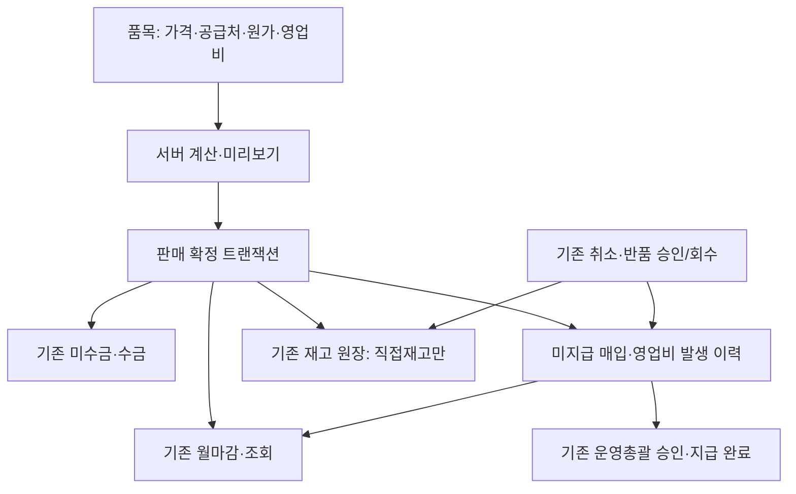

# Issue #640 — 상품 판매 자동 연결

상위 화면 변경은 Draft #639 브랜치에 유지한다. 이 PR은 해당 브랜치에 의존하는 별도 Draft이며 main 병합·운영 migration·Production 배포를 포함하지 않는다.

## 데이터 계약

- `erp_sales_items.pricing_basis`: exclusive 기본값으로 기존 단가 의미 보존. automation NULL은 기존 수동 거래를 유지한다. 과거 거래 backfill 없음.
- `automation`: 기본 공급처·단위 매입가격·매입 VAT/세금·공급처 지급 주기·출고 방식·영업비 조건. 거래별 영업비 명시값 > 품목 기본값. 기존 거래처/영업자 테이블에는 별도 비율 기본값이 없다.
- `erp_sales_parties.item_prefix`: 최초 등록 후 유지. 미지정 공급처는 UUID 기반 접두어, 공급처 없는 서비스는 COM. 번호 제안은 비예약이며 실제 저장은 접두어 lock + unique 제약으로 보호한다. 직접 코드를 입력하면 자동 생성 해제.
- `erp_sales_transactions.automation_snapshot`: 판매 당시 입력가격, VAT 구분, 코드·단위·원가·영업비·출고 방식을 보존. 별도 raw request hash로 품목 수정 이후에도 동일 요청 재시도 가능.
- 신규 `erp_sales_accrual_events` 한 테이블: 매입 공급가·매입 VAT·영업비 발생/반대 금액. 기존 실제 지출 `erp_sales_purchases`와 구분. RLS/직접 쓰기 금지/수정·삭제 금지.
- 기존 미수금 계산, 수금, 지급 승인/완료, 재고 수불, 취소·반품/환불, 상계, 마감/재개방 RPC를 재사용한다. 확정 RPC 전체가 원자적이며 재고 실패 시 모든 기록을 되돌린다.
- 반품 매입원가: 원본 수량 대비 누적 비례 반대 이력. 공급가·VAT 반올림 차이는 합계에 맞춰 마지막 잔여에 반영한다. 영업비는 원본 청구금액 대비 승인 반품액 비례로 감액한다. 이미 지급한 금액은 삭제하지 않고 회수 필요액을 표시하며 기존 영업비 정정/상계 절차를 사용한다.
- 취소는 배송 전 기존 검증을 따른다. 직접재고 반품은 승인만으로 입고하지 않고 실제 회수 기록 시 복구한다.
- 서로 다른 공급처·출고 방식·지급 주기·기본 영업비 상품은 판매를 나누거나 거래별 영업비를 명시해야 한다.
- 월마감의 발생 합계는 기록일 기준. 선택 월 매출의 미수·미지급은 조회 시점 현황으로 명시한다. 과거 시점 현황으로 오인하지 않게 한다.

## 격리 DB 실행 증거

실제 PostgreSQL 17.11, 합성 사용자·거래처·상품만 사용. 로컬 Docker 불가 환경에서는 외부 임시 PostgreSQL 실행 파일과 pg 클라이언트로 동일 fixture SQL/RPC를 실행했다. 저장소 런타임 의존성은 추가하지 않았다. CI는 기존 PostgreSQL17 Docker fixture를 사용한다.

| 거래 | 검증값 |
|---|---:|
| 뉴질랜드 천일염 10kg / 1포 / VAT 포함 | 25,000원 |
| 공급가액 / VAT | 22,727원 / 2,273원 |
| 합성 매입 공급가 / VAT | 13,636원 / 1,364원 |
| 공급가 10% 영업비 | 2,273원 |
| 부분 수금 / 남은 미수 | 10,000원 / 15,000원 |
| 부분 수금 시 영업비 지급 허용 | 909원 |
| 최종 수금 / 미수 | 25,000원 / 0원 |
| 승인 후 실제 지급 | 공급처 15,000원 + 영업비 2,273원 |
| 직배송 재고 차감 / 허위 현금 구매 | 각각 0건 |

44개 격리 DB 검증 통과: 중복·동시 확정, 동시 코드 생성, 공급처 이름 변경, 가격 포함/별도 재조회, 직접재고 부족 시 전체 rollback, 반품 승인/회수 분리, 누적 반품·취소 복구, 마감 차단/승인 재개방, 중단 품목 신규 차단/기존 원본 보존, 무권한 조회·직접 변경 차단.

브라우저·Auth API·전체 migration CI는 PR 최신 실행 결과를 따른다. 통과 전 완료로 취급하지 않는다. Preview는 운영 서버 migration 미적용 상태에서는 새 자동 연결 기능을 노출하지 않는다. 전체 기능은 격리 DB 브라우저 검증으로 확인하며 운영 서버를 미리 변경하지 않는다.
